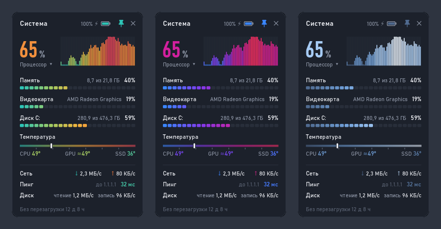

# PC Monitor — виджет для рабочего стола Windows

Лёгкий монитор ноутбука/ПК: загрузка процессора, памяти и видеокарты,
место и активность диска, сеть и пинг, температуры, батарея — в виджете на
рабочем столе и в мини-панели прямо на панели задач.


Все значения окрашены по одной шкале «холодно → горячо»: чем краснее, тем
больше нагрузка или температура. Три палитры на выбор:



Компактный режим, карточка при наведении на мини-панель и сама мини-панель:


## Возможности
- **Процессор** — число и гистограмма за последнюю минуту. Клик по блоку
  раскрывает топ-5 программ по нагрузке (одноимённые процессы суммируются,
  память — как в диспетчере задач).
- **Память, видеокарта, диски** — сегментные шкалы.
- **Температуры CPU / GPU / SSD** — через LibreHardwareMonitor (см. ниже).
  У встроенной графики без своего датчика показывается общая температура
  кристалла со значком «≈».
- **Сеть** (↓ ↑), **пинг** до 1.1.1.1, активность диска, батарея, время без
  перезагрузки.
- **Мини-панель на панели задач** слева от значков трея: CPU/RAM, сеть, пинг,
  температуры. Наведение — подробная карточка, клик — открыть виджет.
  Кнопки приложений сдвигаются и возвращаются при выходе. В полноэкранных
  играх и при автоскрытии панели задач — прячется.
- **Предупреждения** карточкой в углу: перегрев CPU ≥ 90° / GPU ≥ 87°,
  память ≥ 90% (с указанием, кто её съел), батарея ≤ 15% без зарядки.
  Каждое — не чаще раза в 10 минут, фокус у игры не отбирают.
- **Закрепление на рабочем столе** (кнопка 📌): виджет живёт под окнами,
  не пропадает по Win+D и не двигается. Серая 📌 — можно перетаскивать.
- **Горячая клавиша Ctrl+Alt+W** — показать/скрыть виджет.
- **Автозапуск** с Windows, **компактный режим**, палитры, непрозрачность —
  всё в меню по правому клику. Повторный запуск не создаёт вторую копию.

## Установка и запуск
Нужны Windows 10/11 и Python 3.10+.

```
python -m pip install -r requirements.txt
```

Запуск — двойной клик по `start.bat` (или по `widget.pyw`).
Настройки и позиция сохраняются в `widget_config.json` рядом с программой.

## Температура
Windows не отдаёт настоящие температуры процессора обычным программам —
их можно прочитать только через драйвер. Поэтому виджет берёт их из
[LibreHardwareMonitor](https://github.com/LibreHardwareMonitor/LibreHardwareMonitor):

1. Скачай последний релиз и запусти `LibreHardwareMonitor.exe` от имени
   администратора (если предложит поставить драйвер PawnIO — соглашайся).
2. Включи `Options → Remote Web Server → Run` (порт 8085).
3. По желанию: `Options → Start Minimized`, `Minimize To Tray`,
   `Run On Windows Startup`.

Без него всё остальное работает, вместо температур будет «нет данных».

## Как это устроено
- Один файл `widget.pyw`: tkinter-окно без рамки, всё рисуется Pillow
  (с суперсэмплингом), шрифт Bahnschrift из Windows.
- Данные: `psutil`; процессы — одним вызовом `NtQuerySystemInformation`,
  как в диспетчере задач; пинг — `IcmpSendEcho` (без прав администратора).
- Закрепление: окно принадлежит значкам рабочего стола (`SHELLDLL_DefView`);
  мини-панель — панели задач (`Shell_TrayWnd`).

Проверено на Windows 10 (1600×900, 100%).
