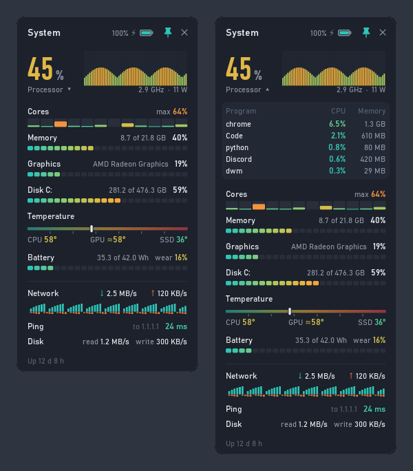
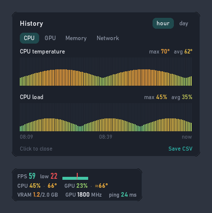

# PC Monitor — a desktop widget for Windows

A light monitor for your laptop or PC: CPU, memory and GPU load, disk space
and activity, network and ping, temperatures and battery. It sits in a widget
on the desktop and in a mini panel right on the taskbar.



Every value is coloured on one "cool → hot" scale: the redder, the higher the
load or temperature. Three palettes to choose from, or your own two colours
(Settings → Look → "Choose custom colours…"):


Compact mode, the hover card of the mini panel and the panel itself:


CPU history for the last hour or day, and the FPS counter in a game with the
1% low and a frame-time graph (a red bar is a stutter):



## Features
- **Processor** — the load and a histogram of the last minute, clock and
  power (with admin rights). Click the block to see the top 5 programs by
  load (processes with the same name are added up, memory as in Task Manager).
- **Cores** — a bar per logical processor, so one overloaded core (a game,
  a stuck program) is visible even when the average is low.
- **Memory, graphics, disks** — segment meters; a plugged-in USB stick shows
  up by itself.
- **CPU / GPU / SSD temperatures** — with admin rights (see below).
  Integrated graphics without a sensor of its own shows the shared chip
  temperature marked with "≈".
- **Network** (↓ ↑) with a one-minute graph (download up, upload down),
  **ping** (to 1.1.1.1, 8.8.8.8, 9.9.9.9 or your own address — Settings →
  Network and games), disk activity, uptime.
- **History** — click the temperature block (or the menu "History (hour and
  day)"): charts of CPU, GPU, memory or network for the last hour or day with
  the maximum and average, and "Save CSV" for the whole day. Kept in
  `%APPDATA%\PC-Monitor\history.csv` (a point every 10 s, one day at most),
  so it survives restarts.
- **Battery** — charge and how long it will last (Windows' estimate), wear
  (how much capacity is lost since new) and the power draw in watts when
  unplugged.
- **Fans** — fan speeds, when the PC reports them (board fans need admin
  rights; many laptops don't report fans at all).
- **Show** (Settings) — hide the rows you don't need: graphics, disks, network
  graph, ping and so on.
- **Mini panel on the taskbar**, left of the tray icons: CPU/RAM, network,
  ping, temperatures. Hover for a detailed card, click to open the widget.
  The task buttons move aside and get their space back on exit. It hides in
  fullscreen games and when the taskbar auto-hides.
- **Alerts** as a card in the corner: CPU overheating (from 90° by default,
  GPU 3° earlier), memory from 90% (with the program that ate it), battery
  below 15% when unplugged. The limits are in Settings → Alerts. Each alert at
  most once in 10 minutes; they never take the focus from a game.
- **Profiles "Work" and "Game"** — each remembers its own look (compact or
  full, size, colours, rows, opacity, mini panel). Switch from the right-click
  menu; "Game" turns on by itself while a game is running and switches back
  afterwards. Alert cards never pop up over a game (they still go to Telegram).
- **Alerts in Telegram** — the same alerts also go to your own Telegram bot
  (Settings → Telegram: paste the token from @BotFather, click Connect, write
  to the bot, click Connect again). The token is kept encrypted with Windows'
  DPAPI, readable only by your Windows user.
- **Pin to the desktop** (📌 button): the widget lives under the windows,
  survives Win+D and can't be moved. Grey 📌 — it can be dragged.
- **FPS in games** — a small panel in the corner of the game window (clicks go
  through it): "FPS 60 · low 48" with a frame-time graph where stutters stand
  out in red, and below it CPU and GPU load and temperature and the ping (to
  the address chosen in Settings). Frames are counted from Windows' own events for every presented frame
  (like PresentMon), so DirectX 9–12, OpenGL and Vulkan games all count.
  low ("1% low") = the 99th percentile frame time over the last 10 s. Windows doesn't
  let anything draw over *exclusive* fullscreen — use windowed or borderless.
  Browsers, chats and players don't count as games.
- **Hides itself** while a game (FPS shown) or a fullscreen video is in front
  and comes back afterwards; or just dims to 30%, or does nothing (Settings →
  Look). Ctrl+Alt+W during a game shows it anyway.
- **Tray icon** next to the clock: left click shows/hides the widget, right
  click opens the menu, hover shows CPU, RAM and temperature. Can be switched
  off in Settings.
- **Languages**: Russian, English, Ukrainian, German — as in Windows or from
  Settings → General.
- **Hotkey Ctrl+Alt+W** — show/hide the widget.
- **Start with Windows**, **compact mode**, **size** (100/125/150%), palettes, opacity — all in the
  **Settings** window (right-click → "Settings…"); the right-click menu keeps
  only the everyday items. Starting it twice doesn't open a second copy.
- **Updates** — every 6 hours the widget asks GitHub whether a new version is
  out and, if so, shows a "Version … is out" row and one card. It never
  downloads or installs anything by itself. Off in "About → Check for updates".
- **The cross** closes the widget on the second click (the first one turns it
  red: "Click again to close"), so a slip next to 📌 doesn't quit it.

## Installation
Windows 10 is needed (for Windows 11 see below). Website:
[vladzah403.github.io/pc-widget](https://vladzah403.github.io/pc-widget/).

1. Download `PC-Monitor-Setup.exe` from
   [Releases](https://github.com/vladZah403/pc-widget/releases) and run it. It
   installs for your user only (no admin rights) into
   `%LOCALAPPDATA%\Programs\PC-Monitor`, adds a Start menu shortcut and can be
   removed from "Apps & features".
2. Or take `PC-Monitor.zip`, unpack it into any folder and run
   `PC-Monitor.exe` — a portable copy.

Later versions install from the widget itself: "Version … is out — update".

**SmartScreen warning.** The program isn't signed with a certificate (that
costs money), so Windows shows "Windows protected your PC". Click "More info"
→ "Run anyway". An antivirus may react the same way: programs built with
PyInstaller look alike and heuristics get it wrong. All the source code is in
this repository — you can build it yourself (see below).

Settings, the error log (`pc-monitor.log`) and diagnostics are in
`%APPDATA%\PC-Monitor`. If something doesn't work, send `pc-monitor.log` and
the output of `PC-Monitor.exe --diag` (`pc-monitor-diag.txt` in the same
folder).

### From source
Python 3.10+ is needed:

```
python -m pip install -r requirements.txt
```

Run `start.bat` (or `widget.pyw`). `build_exe.bat` builds `PC-Monitor.zip`
(needs the packages from `requirements-build.txt` and the LibreHardwareMonitor
DLLs listed in `lhm-files.txt` in the `lhm/` folder, see below).

### Tests
`python -m pytest tests` (needs `pip install pytest`). They load `widget.pyw`
with `%APPDATA%` in a temp folder and never touch the real settings, the
taskbar or the sensors; GitHub Actions runs them before every build.

### Releasing a version
GitHub Actions does the build (`.github/workflows/build.yml`): on every push
to `main` it builds `PC-Monitor.zip` on Windows and checks that the program
starts (the zip is kept as a run artifact). LibreHardwareMonitorLib comes from
its official release, checked by SHA-256.

To release: raise `APP_VERSION` in `widget.pyw`, write the notes in
`docs/releases/vX.Y.md`, then `git tag -a vX.Y -m "PC Monitor X.Y"` and
`git push origin vX.Y` — Actions creates the Release with the zip.

## Temperatures and admin rights
Windows doesn't give real CPU temperatures to ordinary programs — they are
read through a driver. The widget does it itself with
[LibreHardwareMonitorLib](https://github.com/LibreHardwareMonitor/LibreHardwareMonitor)
(MPL-2.0 license), but only with admin rights. So:

- by default the widget runs **without** admin rights: everything but the
  temperatures is shown right away;
- temperatures are switched on in Settings: **"Admin rights (temperatures)"**.
  The PawnIO driver is needed (installed once; LibreHardwareMonitor installs
  it too);
- in this mode the program copies itself to `C:\Program Files\PC-Monitor` and
  from then on runs with admin rights only from there. Nothing can be written
  there without admin rights — so no program can swap the widget's files to
  get admin rights through it;
- autostart in this mode goes through the Task Scheduler (no UAC prompt at
  logon), also only for the copy in Program Files. The source version
  (`widget.pyw`) never gets such an autostart: Python and its packages live in
  folders anyone can write to.

**To remove** the copy in Program Files: switch off "Start with Windows" and
"Admin rights" in Settings, close the widget and delete
`C:\Program Files\PC-Monitor`.

**LibreHardwareMonitor** as a separate program isn't needed any more. If the
widget, without admin rights, sees its web server (`Options → Remote Web
Server`), it takes the temperatures from there — but that server has no
password and, if the firewall lets it through, is visible to everyone on your
network. Better leave it off unless you need it. The widget only connects to
`127.0.0.1`.

To run from source, put the DLLs from a LibreHardwareMonitor release
(`LibreHardwareMonitorLib.dll` and its dependencies) into `lhm/` and install
`pythonnet` (`pip install -r requirements.txt`).

## Windows 11
Windows 11 has a different taskbar: the task buttons can't be moved aside, so
the mini panel may cover icons. That's why it's off there by default — switch
it on in Settings → "Mini panel on the taskbar". Tested only on Windows 10.

## How it works
- `widget.pyw` (+ translations in `translations.py`): a borderless tkinter
  window, everything drawn with Pillow (supersampled), the Bahnschrift font
  from Windows.
- Sensors: LibreHardwareMonitorLib via `pythonnet` (or the LHM web server).
- Data: `psutil`; processes with one `NtQuerySystemInformation` call, as Task
  Manager does; ping via `IcmpSendEcho` (no admin rights needed); FPS from the
  Microsoft-Windows-DXGI ETW provider.
- Pinning: the window is owned by the desktop icons (`SHELLDLL_DefView`); the
  mini panel by the taskbar (`Shell_TrayWnd`).

Tested on Windows 10 (1600×900, 100%).
