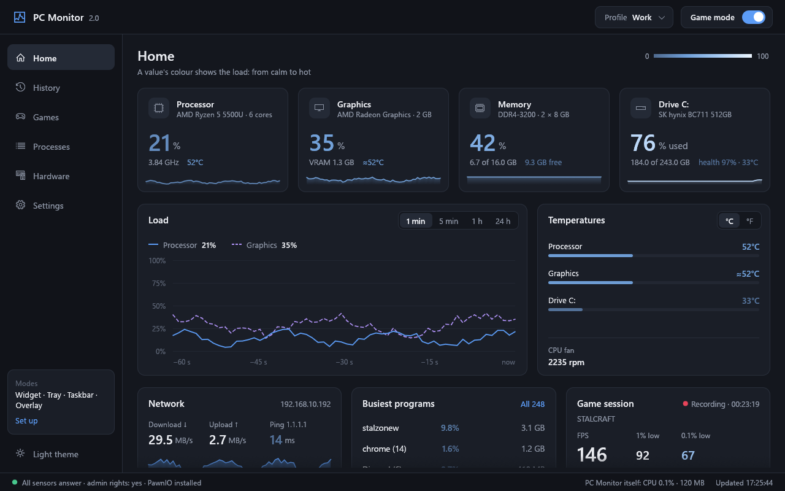
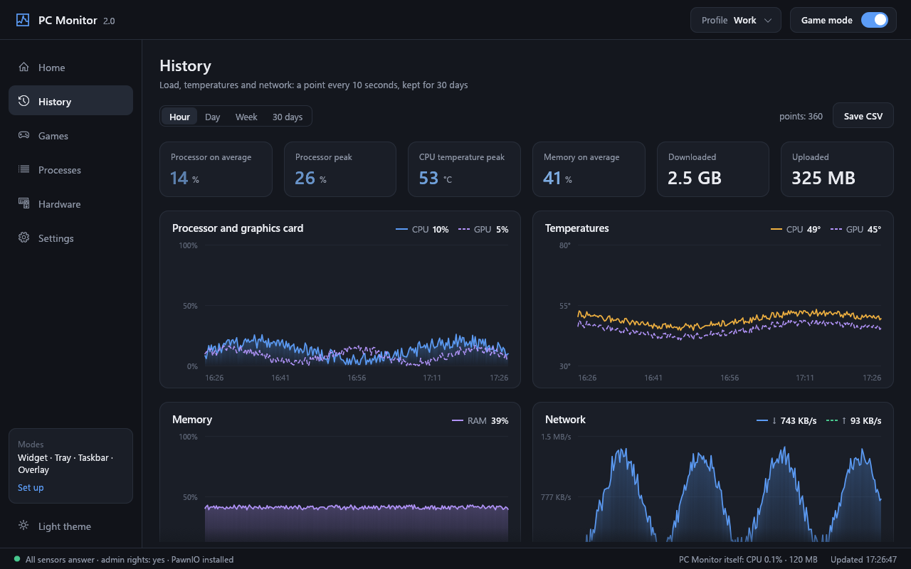
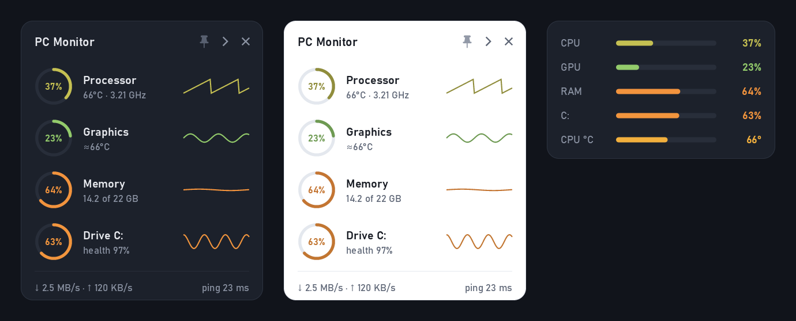
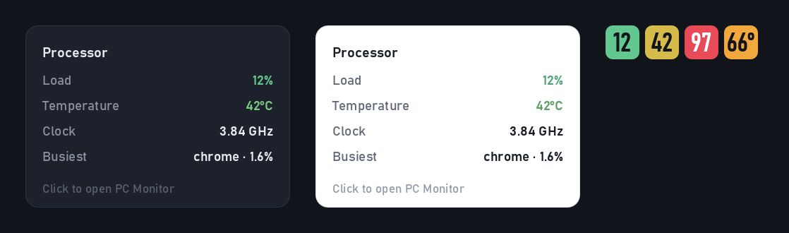
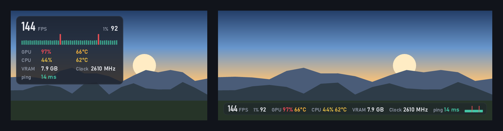
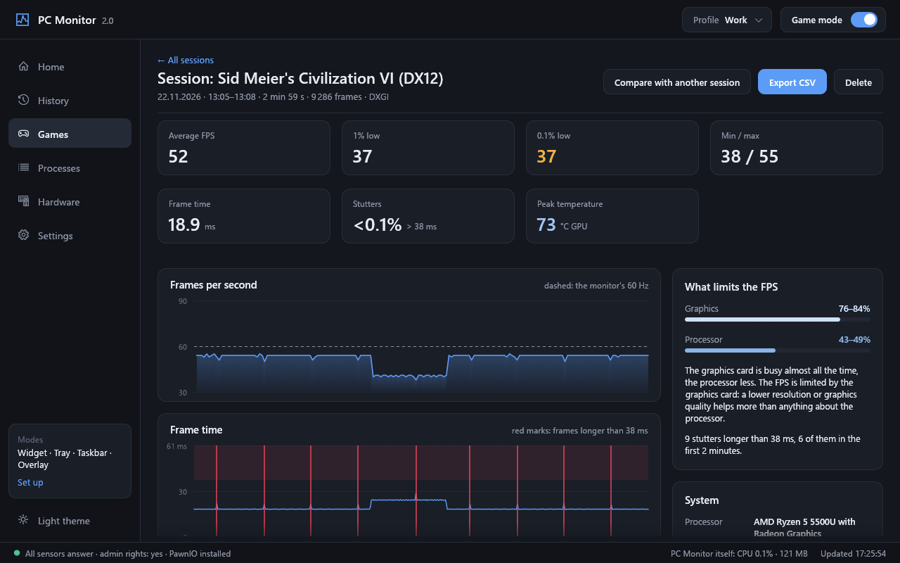

# PC Monitor — load, temperatures and FPS for Windows

PC Monitor shows your laptop's or PC's load, temperatures, network and FPS:
in its own window, in a widget on the desktop, in the tray, on the taskbar and
over your game. Version 2.0 is rewritten in Rust: one small program, about
15 MB of memory and well under 1% of one CPU core at idle.

Website: [vladzah403.github.io/pc-widget](https://vladzah403.github.io/pc-widget/) ·
Download: [PC-Monitor-Setup.exe](https://github.com/vladZah403/pc-widget/releases/latest/download/PC-Monitor-Setup.exe)



Every value is coloured on one "calm → hot" scale: the redder, the higher the
load or temperature.

## The PC Monitor window
- **Home** — processor, graphics card, memory and drive at a glance, a load
  chart (1 min to 24 h), temperatures and fans, network and ping, the busiest
  programs and the game being played.
- **History** — load, temperatures, memory and network for the last hour, day,
  week or 30 days (a point every 10 s), with "Save CSV".
- **Games** — every game session with its report (see below).
- **Processes** — search, sort by CPU or memory, close a program (Windows' own
  processes can't be closed from here).
- **Hardware** — a card for every part: CPU, graphics, memory, drives with SSD
  health, battery, network, the system.
- **Settings** — everything in one place, as cards with switches.
- **Light or dark** — one switch at the bottom of the page list.

Closing the window keeps the widget, tray icons and taskbar panel running, or
quits altogether — your choice in Settings.



## The widget
Optional (Settings → "Show the widget", or **Ctrl+Alt+W**). Two looks:
**Cards** (dark or light, with a compact list) and **Classic**, the 1.8 widget
with everything it had — cores, memory, graphics, disks, temperatures,
battery, SSD health, fans, network graph, ping, disk activity.



- **Any shape and size** (Classic): drag the edges or the corner; wider, the
  rows go into two or three columns. Ctrl + mouse wheel: 80 to 200%.
- **Pin to the desktop** (under the windows, survives Win+D) or keep it on top;
  it sticks to screen edges while you drag it.
- **Tuck it behind the screen edge**: a click on the small tab at its side, and
  only the tab stays.
- **Hides itself** while a game or a fullscreen video is in front (or dims, or
  stays).
- **Palettes**: Warm, Neon, Ice or two colours of your own; any opacity.

## Tray and taskbar
- **Tray icons** — up to three numbers on coloured squares (CPU, temperature,
  memory, GPU…). Hover one for a card with the details, click it to open the
  window.
- **Taskbar panel** left of the tray icons: CPU/RAM, network, ping,
  temperatures; the task buttons move aside and get their space back on exit.
  Off by default on Windows 11 (see below).



## In games
- **FPS panel** in a corner of the game: FPS, 1% low, a frame-time graph where
  every stutter shows up red, CPU and GPU load and temperature, video memory,
  GPU clock and ping. A card, the 1.8 look or one line; pick the rows, size
  and background with a live preview in Settings. **Ctrl+Alt+F** hides or
  shows it. Frames are counted from Windows' own events for every presented
  frame (like PresentMon), so DirectX 9–12, OpenGL and Vulkan games all count.
  Windows lets nothing draw over *exclusive* fullscreen — use windowed or
  borderless.
- **Game sessions**: every game is recorded; afterwards a report — average FPS,
  1% / 0.1% lows, frame time, stutters, load and temperature over time, what
  held the FPS back, the system, your note, comparing two sessions, CSV of
  every second and every frame.
- **Profiles "Work" and "Game"**, each with its own look; "Game" turns on by
  itself while you play.





## Also
- **Alerts** as a card in the corner: CPU overheating, memory running out,
  low battery, little space on C:, a worn or failing SSD. At most once in 10
  minutes each, never over a game.
- **Languages**: English, Russian, Ukrainian, German — as in Windows or from
  Settings.
- **Updates**: every 6 hours PC Monitor asks GitHub whether a new version is
  out and shows it once; one click installs it. An update is installed only if
  it carries the release signature (Ed25519, minisign), besides GitHub's
  checksum. Off in Settings → Updates.
- **Starting it twice** doesn't open a second copy: it brings up the window.

## Installation
Windows 10 or 11, 64-bit.

1. Download [`PC-Monitor-Setup.exe`](https://github.com/vladZah403/pc-widget/releases/latest/download/PC-Monitor-Setup.exe)
   and run it. It installs for your user only (no admin rights) into
   `%LOCALAPPDATA%\Programs\PC-Monitor`, adds a Start menu shortcut and can be
   removed from "Apps & features".
2. Or take [`PC-Monitor.zip`](https://github.com/vladZah403/pc-widget/releases/latest/download/PC-Monitor.zip),
   unpack it into any folder and run `PC-Monitor.exe` — a portable copy.

**Coming from 1.8?** It updates itself to 2.0 and keeps your settings,
autostart and history; or install the setup over it. **Tried a 2.0 beta**
("PC Monitor 2")? Remove it in "Apps & features" first, then install 2.0.

**SmartScreen warning.** The program isn't signed with a code-signing
certificate yet, so Windows may show "Windows protected your PC": click
"More info" → "Run anyway". All the source code is in this repository.

The PC Monitor window needs OpenGL (any PC with a graphics driver).

Settings, history and game sessions are in `%APPDATA%\PC-Monitor`. If
something doesn't work, open an issue with the output of
`PC-Monitor.exe --diag` (or `--diag --out diag.txt`).

## Temperatures and admin rights
Windows doesn't give real CPU temperatures to ordinary programs — they are
read through a driver. PC Monitor does it with
[LibreHardwareMonitorLib](https://github.com/LibreHardwareMonitor/LibreHardwareMonitor)
(MPL-2.0) in a small helper (`_internal\pcm-sensors.exe`, .NET Framework 4.8,
built into Windows), but only with admin rights. So:

- by default PC Monitor runs **without** admin rights: everything but the CPU
  temperatures is shown right away;
- temperatures are switched on in Settings → "Startup and closing" → **"Admin rights
  (temperatures)"**. The free PawnIO driver is needed on some PCs (installed
  once; LibreHardwareMonitor installs it too);
- in this mode the program copies itself to `C:\Program Files\PC-Monitor` and
  from then on runs with admin rights only from there. Nothing can be written
  there without admin rights, so no program can swap PC Monitor's files to get
  admin rights through it;
- autostart in this mode goes through the Task Scheduler (no UAC prompt at
  logon), also only for the copy in Program Files.

Without admin rights the graphics temperature still comes from the driver
(D3DKMT) on many PCs, and SSD health from the drive's own NVMe log. When there
is no CPU temperature, the hottest ACPI thermal zone is shown, marked "≈".

## Windows 11
- Windows 11's taskbar can't move the task buttons aside, so the taskbar panel
  may cover icons. That's why it's off there by default — switch it on in
  Settings.
- **Smart App Control** (on on many fresh Windows 11 installs) blocks programs
  that aren't code-signed: the setup stops with "error 4551". Until the
  releases are signed it runs only with Smart App Control off: Windows
  Security → App & browser control → Smart App Control.

## Building from source
Rust (stable, MSVC toolchain) and Visual Studio Build Tools (C++ workload):

```
cargo build --release -p pcm-app
```

- `crates/pcm-core` — data model, settings (TOML), history (SQLite), game
  sessions (zstd), updates; no Windows calls.
- `crates/pcm-win` — Windows: PDH, D3DKMT, ETW frame counting, NVMe, network,
  ping, battery, autostart, WinHTTP.
- `crates/pcm-render` — the widget, tray icons, FPS panel and charts, drawn
  with tiny-skia and the Bahnschrift font from Windows.
- `crates/pcm-app` — `PC-Monitor.exe`: the widget, tray and panel windows; the
  PC Monitor window (egui) runs as a child process, so closing it frees its
  memory.
- `sensors-helper` — `pcm-sensors.exe` (C#), LibreHardwareMonitorLib's
  readings as JSON lines; `build.bat` builds it with the .NET Framework
  compiler (the DLLs listed in `lhm-files.txt` go into `lhm/`).

Tests: `cargo test --workspace`. GitHub Actions (`.github/workflows/rust.yml`)
on every push also checks formatting and clippy, builds the zip and the setup,
measures idle CPU and memory, installs and uninstalls the setup, updates a
1.8 install to the new build and lets the build update itself.

**Releasing**: raise `version` in `Cargo.toml`, write
`docs/releases/vX.Y.Z.md`, tag `vX.Y.Z` and push it — Actions builds and
publishes a pre-release. The zip is then signed with the release key (kept
off this repository) into `signatures/vX.Y.Z.minisig`; pushing it lets
`release-signature.yml` check the signature, attach it and make the release
the latest one.

PC Monitor 1.8 (Python) is in `widget.pyw`; its releases are tagged `v1.*`.

## Code signing policy
The releases are not code-signed yet, so Windows SmartScreen may warn about
them and Smart App Control on a fresh Windows 11 may block them.

- Committers, reviewers and approvers: [vladZah403](https://github.com/vladZah403)
- Every release is built by GitHub Actions from this repository
  (`.github/workflows/rust.yml`), from a tagged commit. The only thing done by
  hand is the update signature of the built zip, which the program checks
  before installing an update.

### Privacy
PC Monitor sends nothing about you or your PC anywhere. It connects to the
network only to:
- ask GitHub whether a new release is out (`api.github.com`, every 6 hours;
  off in Settings → Updates);
- download a new release, when you click "update" (`github.com`);
- ping the address you chose (1.1.1.1 by default; Settings).

Settings, history and game sessions stay in `%APPDATA%\PC-Monitor`.

## License
[MIT](LICENSE). The bundled LibreHardwareMonitorLib is under the
[MPL-2.0](https://github.com/LibreHardwareMonitor/LibreHardwareMonitor/blob/master/LICENSE).
